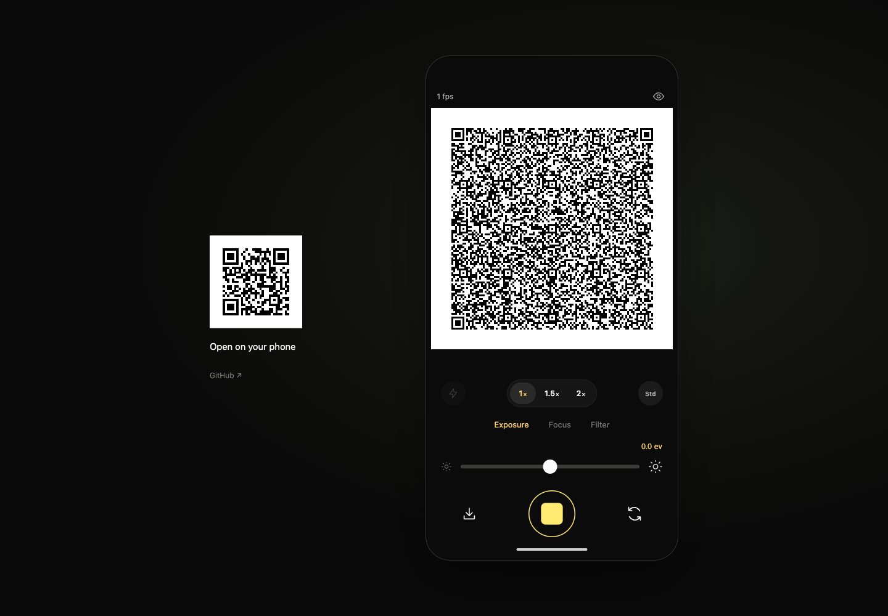
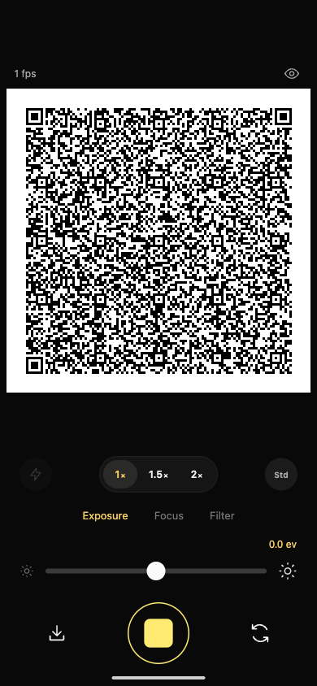
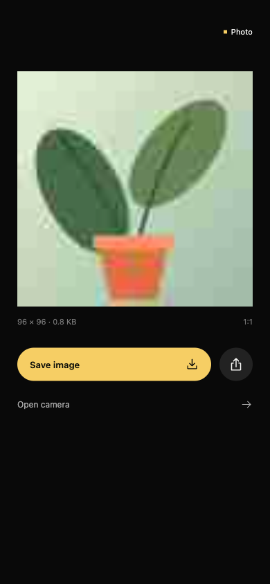
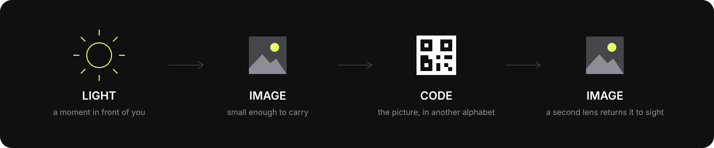

# QameRa

[English](README.md) | **한국어**

**카메라는 다 봤다. 당신은 아직 아무것도 보지 못했다.**

사진 대신 QR 코드를 보여주는 카메라. 무언가를 향해 렌즈를 들면, 화면 가운데의 정사각형이 계속 다시 쓰인다. 무엇을 봤는지 알고 싶다면 다른 카메라에게 물어보면 된다.

[휴대폰에서 QameRa 열기](https://taewooopark.github.io/QameRa/) · [작동 방식](#빛--이미지--코드--이미지) · [로컬 실행](#로컬-실행)



## 잠시 읽을 수 없게 된 이미지

QameRa에는 카메라의 익숙한 동작이 남아 있다. 밝기를 바꾸고, 필터를 고르고, 가까이 당기고, 한순간을 멈춘다. 다만 사진이 있어야 할 자리에는 그 사진을 되돌리는 데 필요한 코드가 놓인다.

QR은 다른 문자로 쓰인 사진이다. 두 번째 휴대폰이 코드를 읽고 링크를 열면, 링크 안에 들어 있던 작은 이미지가 다시 나타난다. 첫 번째 카메라가 보고, 두 번째 카메라가 번역한다.

> 추억은 기계가 읽을 수 있는 상태로 보관해 주세요.

## 사용하기

1. 모바일 브라우저에서 **[QameRa](https://taewooopark.github.io/QameRa/)**를 연다. 2초간의 인트로가 끝나면 **Open camera**를 누르고 카메라 접근을 허용한다.
2. 렌즈를 향한다. **가운데 1:1 뷰파인더에는 실시간 QR**이 나타나며, 일반적인 카메라 미리보기는 표시되지 않는다.
3. 조작부에서 이미지를 조정한다. 바뀐 밝기와 필터도 QR 안에 담긴다.
4. 셔터를 눌러 **QR을 고정한다**. 다른 휴대폰의 카메라로 스캔하고 인식된 링크를 연다.
5. 그 순간의 이미지가 나타난다. 첫 번째 카메라를 다시 재생하면 새로운 순간을 만들 수 있다.

실시간 QR은 스캔 중에도 바뀔 수 있다. 셔터로 멈추면 다른 카메라가 전체 패턴을 읽을 시간을 확보할 수 있다. 스캔해서 열리는 것은 **한 프레임의 사진**이며, 원격 실시간 영상은 아니다.

<table>
  <tr>
    <td width="50%" align="center"><br/><strong>이 카메라가 보여주는 것</strong><br/>코드로 쓰인 이미지.</td>
    <td width="50%" align="center"><br/><strong>다른 카메라가 읽는 것</strong><br/>다시 보이게 된 같은 순간.</td>
  </tr>
</table>

위 이미지는 생성한 데모 장면을 넣어 실제 실행 화면을 캡처한 것이다. 인터페이스와 이미지 복원을 보여주며, 실제 피사체를 촬영했거나 두 대의 휴대폰으로 스캔을 마쳤다는 의미는 아니다.

## 조작

| 조작부 | 동작 |
| --- | --- |
| 셔터 | 한 번 눌러 현재 QR을 고정하고, 다시 누르면 실시간 촬영으로 돌아간다. |
| 카메라 전환 아이콘 | 사용 가능한 전면·후면 카메라를 전환한다. |
| Exposure | 인코딩할 이미지의 밝기를 −2~+2 EV 범위에서 조정한다. |
| Focus | 하드웨어가 지원할 때 초점을 수동 조정하거나 Auto로 되돌린다. |
| Filter | Original, Mono, Amber, Ghost 중 색감을 고른다. |
| 1× / 1.5× / 2× | 카메라 이미지의 일부를 디지털 방식으로 확대한다. |
| 조명 아이콘 | 기기와 브라우저가 지원할 때 카메라 조명을 켜거나 끈다. |
| 1 fps / 2 fps / 0.5 fps | QR 갱신 속도를 순서대로 바꾼다. |
| Std / Fine | URL 길이 한도를 1,150자 또는 2,200자로 고른다. Fine은 이미지의 세부 묘사를 더 담는 대신 QR이 촘촘해진다. |
| 저장 아이콘 | 현재 QR을 이미지로 내려받는다. |
| 눈 아이콘 | 현재 프레임을 고정하고 같은 휴대폰에서 이미지를 확인한다. |
| Save image / 공유 아이콘 | 복원한 이미지 화면에서 JPEG를 저장하거나 링크를 공유한다. |

하드웨어 제어 범위는 기기마다 다르다. 카메라 촬영을 허용하는 모바일 브라우저라도 수동 초점이나 조명 제어는 제공하지 않을 수 있다. 지원되지 않는 기능은 사용할 수 없다고 표시한다.

## 빛 → 이미지 → 코드 → 이미지



브라우저가 카메라 영상에서 정사각형 프레임을 얻고, 선택한 조정을 적용한 뒤 작은 JPEG로 압축한다. 이미지의 바이트는 URL에 사용할 수 있는 문자열이 되어 링크의 **프래그먼트**, 즉 `#` 뒤에 들어간다. 이 URL 전체를 일반 QR 코드로 만든다. 링크를 받은 페이지가 프래그먼트를 해독해 JPEG를 표시한다.

**이미지 업로드 서버, 사진 데이터베이스, 프레임별 서버 요청은 없다.** GitHub Pages는 앱 파일을 제공한다. 사진은 QR과 링크에 실려 이동한다.

사진의 세부 묘사가 많아질수록 링크가 길어지고 QR도 촘촘해진다. QameRa는 데이터 크기를 제한하기 위해 이미지 크기와 JPEG 화질을 줄인다. 결과는 작고 불완전하다. 순간을 알아볼 만큼은 남기고, 일부는 번역 도중 잃어버린다.

### 사용상의 한계

- QR 갱신 속도는 일반 영상보다 느리다. 안정적으로 스캔하려면 셔터로 고정한다.
- 촘촘한 QR은 흔들림이 적고 화면이 선명하며 정사각형 전체가 들어오는 거리에서 읽기 쉽다. 긴 QR 링크를 처리하는 방식은 카메라 앱마다 다르다.
- 복원되는 것은 저해상도 정지 이미지다. 카메라 원본 해상도까지 되돌리지는 않는다.
- 카메라 접근에는 HTTPS가 필요하다. 개발 중에는 localhost도 가능하다. 앱 내부 브라우저에서 접근이 제한되면 Safari나 Chrome으로 직접 연다.
- 브라우저 검증과 QR 디코딩 테스트가 모든 실제 휴대폰의 호환성을 보장하지는 않는다. 이번 초기 버전은 실제 휴대폰 두 대를 이용한 스캔까지 검증하지 않았다. 자세한 범위는 [검증 기록](docs/verification.md)을 참고한다.

### 사진이 가는 곳

카메라 프레임은 브라우저 안에서 처리된다. URL 프래그먼트는 페이지를 요청하는 HTTP 요청에 포함되지 않는다. 다만 QR이나 전체 링크를 가진 사람은 누구나 사진을 복원할 수 있고, 링크는 브라우저 방문 기록이나 공유한 앱에 남을 수 있다. QameRa는 이미지를 암호화하지 않는다.

### iPhone Chrome에서 권한 팝업이 안 뜬다면

인트로 후 **Open camera**를 누르면 그 탭 동작에서 권한 요청을 바로 시작한다. 자동 타이머로 요청하지 않으며, 응답이 없으면 15초 후 다시 누를 수 있게 복구한다. 영상 재생 준비도 무기한 기다리지 않는다. 눈 모양 버튼은 팝업 없이 같은 탭에서 이미지를 연다.

카메라 시작은 [noisample의 즉시 미디어 요청 구조](https://github.com/TaewoooPark/noisample/blob/39c6b92a6788a4d54f77b58a4bc09fdb81b93a97/dist/engine.js)를 따른다. 입력 핸들러 안에서 비동기 작업을 기다리지 않고 네이티브 API를 호출한 뒤, 허용된 스트림을 설정한다. 터치는 손을 뗄 때, 마우스는 누를 때 시작하며 키보드도 지원한다. 한 번의 입력으로 권한을 중복 요청하지 않는다. 최초 요청은 카메라 방향만 선호 조건으로 전달하고 해상도는 영상이 시작된 뒤 적용한다. 마이크 권한은 요청하지 않는다.

iPhone에서 Chrome의 카메라 접근이 꺼져 있으면 사이트의 권한 팝업도 나타나지 않을 수 있다. **설정 → 앱 → Chrome → 카메라**와 Chrome의 이 사이트 카메라 권한을 허용한 뒤 돌아와 **Open camera**를 다시 누른다. 웹페이지가 이 권한을 대신 켜거나 설정 앱 이동을 강제로 실행할 수는 없다. 앱은 설정 문제라고 단정하지 않고 실제 오류 이름과 실패 단계를 표시한다. 별도 [카메라 진단](https://taewooopark.github.io/QameRa/camera-check.html)에서는 QR 기능 없이 기본 카메라 요청만 테스트하고 결과를 복사할 수 있다. 영상·사진·진단 결과는 서버로 전송하지 않는다. [Google 공식 안내](https://support.google.com/chrome/answer/2693767?co=GENIE.Platform%3DiOS&hl=ko)

## 로컬 실행

**Node.js 22.12 이상**과 npm이 필요하다.

```sh
git clone https://github.com/TaewoooPark/QameRa.git
cd QameRa
npm ci
npm run dev
```

Vite가 출력한 로컬 주소를 연다. 휴대폰으로 개발 버전을 확인하려면 HTTPS 개발 주소나 배포된 사이트를 이용한다. 일반 HTTP 내부망 주소에서는 대개 카메라 권한을 요청할 수 없다.

`localhost`나 `127.0.0.1`에서 실행하면 이미지가 담긴 QR 링크는 공개 QameRa 뷰어를 가리킨다. 다른 휴대폰에서도 링크를 열 수 있게 하기 위해서다. 자신의 배포 주소를 쓰려면 Vite를 실행하거나 빌드하기 전에 `VITE_FRAME_BASE_URL`에 앱의 전체 HTTPS 주소를 설정한다. 배포된 호스트에서는 기본적으로 현재 앱 주소를 사용한다.

```sh
npm test
npm run build
```

빌드 결과물은 정적 사이트다. `main`에 변경 사항이 반영되면 GitHub Actions가 GitHub Pages로 배포한다.

## 디자인과 크레딧

[편집 가능한 Figma 스터디](https://www.figma.com/design/nZW2CrigD44tDAysUYQY22?node-id=1-135)에는 **iOS and iPadOS 26** 라이브러리의 실제 슬라이더와 Liquid Glass 버튼을 사용했다. 웹에서는 자체 SVG 아이콘, HTML/CSS, 기기의 시스템 글꼴로 이를 구현했다. 가운데 워드마크는 2초 뒤 사라진다. 검정과 달걀 노랑(`#f6ce64`), 차분한 대소문자의 기능 이름으로 구성하고 QR 좌우에는 8px의 여백만 둔다. Apple 글리프와 글꼴 파일은 재배포하지 않는다. 사용한 컴포넌트와 라이선스 범위는 [디자인 출처 문서](docs/design-provenance.md)에 기록했다.

QameRa는 [Sound Code Cube](https://github.com/TaewoooPark/Sound-Code-Cube)와 질문을 공유한다. 같은 대상이 서로 다른 지각의 형식으로 옮겨갈 때 무엇이 생기는가. 그곳에서 소리는 코드와 공간이 되었다. 이곳에서 빛은 이미지가 되고, 이미지는 코드가 되며, 다른 렌즈를 지나 다시 보이게 된다.

직접 작성한 코드와 문서는 [MIT License](LICENSE)로 공개한다. 외부 라이브러리와 디자인 에셋에는 각자의 라이선스가 적용된다. [외부 저작물 고지](THIRD_PARTY_NOTICES.md)를 참고한다.
